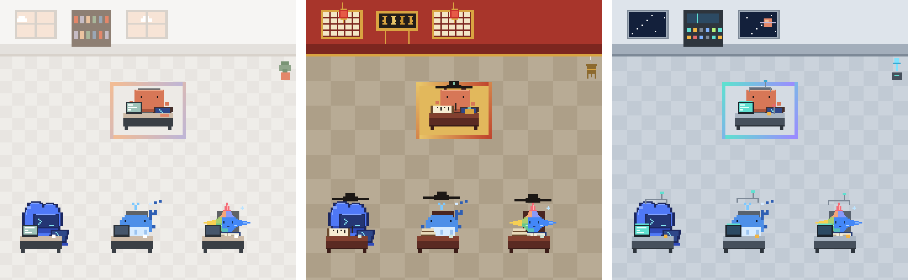

<div align="center">


# AgenTeam

**Focus Your Attention on Valuable Things.**

Every project is a team. You set the direction and make the calls; AI employees get the work done in your local workspace.

[中文](README.md) · **English**

[Quick start](#quick-start) · [How it works](#how-it-works) · [Features](#features) · [Memory](#memory-how-the-assistant-remembers-you) · [Development guide](DEVELOPMENT.md)

[](https://github.com/micsnq2yoma-lgtm/AgenTeam/stargazers) [](https://github.com/micsnq2yoma-lgtm/AgenTeam/actions/workflows/test.yml) [](LICENSE)   



</div>

## How it works

| ① New project | ② New task | ③ Employees do the work | ④ You decide |
| --- | --- | --- | --- |
| Pick a folder (new, existing, or the default location) and optionally turn on assistant mode | Each task starts with the workspace as context and appears as an employee in Agent Team | Claude Agent SDK, DeepSeek Harness or Codex read and write files and run commands on your machine | Steer at any time; hand recurring work to automations |

In the sidebar's **Agent Team** view, every project is a department: the assistant sits at the head desk and employees at their desks, acting out what their task is really doing (working, on schedule, on chat duty, standing by, resting). Click an employee to open the task; click "New employee" to create a new task in that project.

> The structure is **project → assistant → tasks**. A task and an employee are the same thing: Agent Team calls it an employee, everywhere else calls it a task.

## Who it is for

- ✅ You want to organise many AI tasks by project instead of scrolling one long thread
- ✅ You already have Claude / Codex subscriptions or model APIs and want them working on your own computer
- ✅ You want daily checks, tidying and reports to run on a schedule and only wake you when needed
- ❌ Not a multi-user SaaS: one install per computer, with workspaces and tasks stored locally

## Features

| | |
| --- | --- |
| 🗂️ **Projects** A project is a folder: create one, adopt an existing folder, or use the default location; optional assistant mode | 👥 **Agent Team** A pixel office showing every project's employees, with Modern office / Imperial court / Starship skins |
| 🤖 **Runtimes** Claude Agent SDK, DeepSeek Harness, managed Codex, or the Claude Code / Codex CLI on your system | 🔑 **Subscriptions and APIs** Sign in with a subscription or use any model API, chosen per Agent |
| ⏰ **Automations** One-off, interval and Cron schedules; run a script first and wake the Agent only when a condition is met | 🧰 **Skills and tools** Skills capture your methods; MCP connects tools and data (STDIO / HTTP / SSE) |
| 💬 **Chat bots** Built-in Feishu, DingTalk and Telegram, more platforms via plugins | 🛰️ **Multi-device network** Self-hosted AgentNet hands work across devices, end-to-end encrypted |
| 🧠 **Assistant memory** Workspace files as memory: a user profile, long-lived sessions that notice updates, sharing across assistants, optional proactive reminders | 📚 **Knowledge bases** Local conversion and full-text indexing with `kb://` citations, maintainable by a curator Agent |
| 🔍 **Full-text search** The sidebar search bar finds any task by title or content | 🧑‍💻 **CLI** Agents use the `myagents` CLI to create tasks and call other Agents; authorised external Agents can too |

## Memory: how the assistant remembers you

With assistant mode on, the assistant's memory is a few Markdown files in the workspace: no hidden database. You can read and edit them, and they survive a change of Runtime.

```text
Chat / IM / scheduled tasks
   │  Daily learning: 30 minutes after a session goes idle, a background memory-update
   │  appends what it learned to "Recent observations"
   ▼
.claude/rules/            ← loaded into every session
  01-IDENTITY  02-SOUL    identity and character
  03-USER                 who you are: eight fixed chapters (Basics / Background /
                          Communication / Working style / Preferences / Writing style /
                          Recent observations / Sources)
  04-MEMORY               long-term lessons and rules
memory/topics/ · logs     ← read on demand, not in every turn
   ▲
   │  Gardener (about every 3 days): merges "Recent observations", trims what is
   │  auto-loaded, demotes rather than deletes
   │  Molt (about every 2 weeks): reflects on and revises judgements and principles
```

| Capability | What it does |
| --- | --- |
| **Profile from your materials** | Give the assistant a résumé, a personal site or a few documents; a background task reads them and writes `03-USER`, keeping understanding rather than source text |
| **Chapter ownership + checked writes** | Each chapter can be written only by designated flows, and only through `section_edit.py`: it changes just the named chapters, refuses if the file changed since it was read, limits chapters and size, and writes atomically |
| **Long-lived sessions notice updates** | After memory changes, Desktop / IM / Inbox sessions get one tiny hidden reminder on the next turn (which files and chapters changed, never the content) and re-read if needed |
| **Profile shared across assistants** | The earliest-created assistant is the primary; its background, communication, working style, preferences and writing style sync one way to the others (their own basics and recent observations stay; a backup is kept before each change; `shareUserProfile` in `config.json` turns it off) |
| **Proactive reminders (off by default)** | Set `enabled: true` in `memory/PROACTIVE_RULES.md`, or tell the assistant to turn it on. On each heartbeat it decides: tell now / prepare first / follow up later / stay silent. Quiet hours, the daily cap and judging each item once a day are enforced by a script; email and calendar are read only through MCP tools or local CLIs you configure, and AgenTeam stores no credentials |

Principles: workspace files are the only authority for memory; background upkeep reuses the task system; hidden context reuses `system-reminder`. See [Assistant profile and memory](specs/tech_docs/assistant_profile.md).

## Knowledge bases

Turn documents, PDFs and images into a searchable library: sources are converted to normalised Markdown on your machine, indexed for full-text search and cited precisely as `kb://library/source#chunk`. Bind a library to an assistant and it searches with `myagents kb` and answers with citations; each library can name a curator Agent that fills in metadata, maintains wiki pages and proposes categories on a schedule, while physical reorganisation needs your approval. See the [knowledge base contract](specs/tech_docs/knowledge_base.md).

## Quick start

You need Node.js 24.14+ and npm 11.15+ (see [package.json](package.json)). Native builds also need the Visual Studio C++ desktop workload with the Windows SDK, Rustup and CMake; see the [Windows build guide](specs/guides/windows_build_guide.md).

```powershell
git clone https://github.com/micsnq2yoma-lgtm/AgenTeam.git
cd AgenTeam
.\setup_windows.ps1     # prepare Node, dependencies and build resources (slow the first time, cached afterwards)
npm run tauri:dev       # start the desktop dev build
```

| Goal | Command |
| --- | --- |
| Tweak the UI only | `preview_windows.cmd`: browser preview with hot reload; desktop features such as search and files are unavailable |
| Debug desktop features | `.\setup_windows.ps1`, then `npm run tauri:dev` |
| Build an installer | `.\build_windows.ps1 -Candidate -SkipPortable`; output in `src-tauri/target/x86_64-pc-windows-msvc/release/bundle/nsis/` |

On macOS run `./setup.sh` then `./start_dev.sh`; on Ubuntu 24.04 run `./setup.sh` and `./build_dev_linux.sh`. See the [development guide](DEVELOPMENT.md) for details.

Once it is running:

1. **Connect a model**: Settings → Model Providers, sign in to a subscription or enter an API, then pick the Runtime and model. See the [models and Runtime guide](bundled-skills/agenteam-docs/references/models-providers-runtimes.md).
2. **Create a project**: click **+** next to "Projects" in the sidebar, choose the folder location and whether to turn on assistant mode.
3. **Create a task**: create a task in the project, share the material and the goal; for ongoing work, ask the Agent to set up an automation.

App data lives in `~/.myagents` (the upstream MyAgents directory name, kept on purpose; do not rename it).

## What you can change in Settings

- **Team look**: choose the Agent Team skin; on supported systems you can also enable the desktop pet to summon AgenTeam at any time.
- **Chat bots**: connect Feishu / DingTalk / Telegram to a project.
- **Assistant memory**: edit `.claude/rules/03-USER.md` any time to correct the profile; turn off cross-assistant sharing with `shareUserProfile: false` in `config.json`; toggle proactive reminders in `memory/PROACTIVE_RULES.md`.
- **External calls**: authorise other Agents to use AgenTeam through the CLI; see the [external Agent guide](bundled-guides/external-myagents-cli/SKILL.md).

## Architecture

| Path | Contents |
| --- | --- |
| `src/renderer/` | React 19 + Vite desktop UI; `features/team-office/` holds Agent Team and its skins |
| `src/server/` | Node.js Sidecar: SessionEngine and Runtime adapters, one process per session |
| `src-tauri/` | Tauri v2 Rust shell: processes, persistence, HTTP/SSE proxy, automation store |
| `src/cli/` | The `myagents` CLI |
| `src/shared/` | Types and pure logic shared by the UI and the Sidecar |
| `src-tauri/src/profile_sync.rs` `memory_*.rs` | Profile sync, and scheduling of memory update and Gardener / Molt |
| `bundled-workspaces/` `bundled-skills/` | Built-in 小 T assistant template and system skills (memory, profile, knowledge, proactive and more) |
| `specs/` | Architecture, design system, module tech docs and build guides |

## Documentation

- [Development guide](DEVELOPMENT.md): environment, builds, checks and tests
- [Architecture](specs/ARCHITECTURE.md) · [Design system](specs/DESIGN.md)
- [Assistant profile and memory](specs/tech_docs/assistant_profile.md) · [Knowledge bases](specs/tech_docs/knowledge_base.md) · [system-reminder protocol](specs/tech_docs/system_reminder_protocol.md)
- [Tasks and automation](bundled-skills/agenteam-docs/references/automation.md) · [Skills, tools and plugins](bundled-skills/agenteam-docs/references/tools-skills-plugins.md) · [Agents and chat bots](bundled-skills/agenteam-docs/references/agents-channels.md) · [Multi-device network](bundled-skills/agenteam-docs/references/agent-network.md)
- [Changelog](CHANGELOG.md) · [Contributing](CONTRIBUTING.md)

## Star History

[](https://star-history.com/#micsnq2yoma-lgtm/AgenTeam&Date)

## Acknowledgements

AgenTeam stands on the shoulders of these projects; full third-party licences are in [THIRD_PARTY_NOTICES.md](THIRD_PARTY_NOTICES.md).

- [MyAgents](https://github.com/hAcKlyc/MyAgents) (AGPL-3.0-only): upstream of the desktop app, Runtimes and task system
- [AgenTeam pixel-office](https://github.com/micsnq2yoma-lgtm/Agent) (MIT): pixel employees and office
- [claude-code-pixel-pet](https://github.com/zhizunbao-studio/claude-code-pixel-pet): the DeepSeek whale silhouette
- Cormorant Garamond (SIL OFL 1.1): wordmark font

## License

This repository keeps the upstream [GNU AGPL v3.0](LICENSE) (`AGPL-3.0-only`). If you distribute a modified version or offer one to users over a network, you must provide the corresponding source under the AGPL. See [LICENSING.md](LICENSING.md) and [COMMERCIAL-LICENSING.md](COMMERCIAL-LICENSING.md) for details, and the [acknowledgements](#acknowledgements) above for third-party components.
