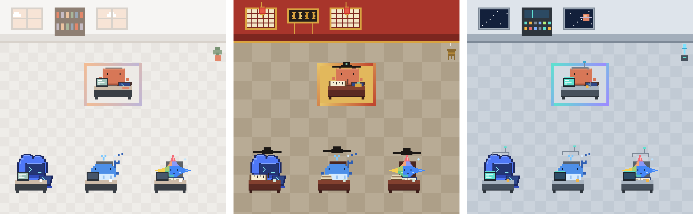

<div align="center">


# AgenTeam

**把注意力放在真正有价值的事情上 · Focus Your Attention on Valuable Things.**

一个项目就是一支团队。你定方向、做决定，AI 员工在本机工作区里把事情做完。

**中文** · [English](README.en.md)

[快速开始](#快速开始) · [它怎么工作](#它怎么工作) · [功能](#功能) · [开发指引](DEVELOPMENT.md)

[](https://github.com/micsnq2yoma-lgtm/AgenTeam/stargazers) [](https://github.com/micsnq2yoma-lgtm/AgenTeam/actions/workflows/test.yml) [](LICENSE)   



</div>

## 它怎么工作

| ① 新建项目 | ② 创建新任务 | ③ 员工去做 | ④ 你来拍板 |
| --- | --- | --- | --- |
| 选一个文件夹（新建、已有或默认位置），按需打开助理模式 | 每个任务带着工作区上下文开工，在智能体团队里就是一名员工 | Claude Agent SDK、DeepSeek Harness 或 Codex 在本机读写文件、跑命令 | 你随时调整方向；持续性的事交给自动化任务 |

在侧栏 **智能体团队** 里，每个项目是一个项目部：助理坐在主位，员工坐在工位上，动作就是任务此刻的真实状态（工作中、定时值守、值守聊天、待命、休息）。点员工打开任务，点「新员工」在该项目里创建一个新任务。

> 结构是 **项目 → 助理 → 任务**。任务和员工是同一个东西：在智能体团队里叫员工，其余地方都叫任务。

## 适合谁

- ✅ 想按项目管理一批 AI 任务，而不是在一条长对话里来回翻
- ✅ 已经有 Claude / Codex 订阅或模型 API，想让它们在自己的电脑上干活
- ✅ 想把每天的检查、整理、汇报交给定时任务，只在需要时被叫醒
- ❌ 不是多人协作的 SaaS：每台电脑一套，工作区和会话保存在本机

## 功能

| | |
| --- | --- |
| 🗂️ **项目管理** 项目 = 文件夹；新建、接管已有文件夹，或用默认位置；可选助理模式 | 👥 **智能体团队** 像素办公室看全部项目的员工状态，现代办公室 / 朝堂 / 星舰皮肤可换 |
| 🤖 **多种 Runtime** Claude Agent SDK、DeepSeek Harness、托管 Codex，也可接系统里的 Claude Code / Codex CLI | 🔑 **订阅与 API** 订阅登录或任意模型 API，按 Agent 单独指定模型 |
| ⏰ **自动化任务** 定时、间隔、Cron；先跑脚本，满足条件再唤醒 Agent | 🧰 **技能与工具** Skill 沉淀方法，MCP 接工具与数据源（STDIO / HTTP / SSE） |
| 💬 **聊天机器人** 内置飞书、钉钉、Telegram，插件扩展更多平台 | 🛰️ **多设备组网** 自建 AgentNet，跨设备交接任务，端到端加密 |
| 🔍 **全文搜索** 侧栏搜索栏检索全部任务的标题和内容 | 🧑‍💻 **CLI** Agent 通过 `myagents` CLI 建任务、调其他 Agent；外部 Agent 授权后也能用 |

## 快速开始

需要 Node.js 24.14+ 和 npm 11.15+（版本见 [package.json](package.json)）。原生构建还需要 Visual Studio C++ 桌面开发工具与 Windows SDK、Rustup 和 CMake，详见 [Windows 构建指南](specs/guides/windows_build_guide.md)。

```powershell
git clone https://github.com/micsnq2yoma-lgtm/AgenTeam.git
cd AgenTeam
.\setup_windows.ps1     # 准备 Node、依赖和构建资源（首次较慢，之后复用缓存）
npm run tauri:dev       # 启动桌面开发版
```

| 想做什么 | 命令 |
| --- | --- |
| 只调界面 | `preview_windows.cmd`：浏览器预览，热更新；搜索、文件等桌面能力不可用 |
| 调试桌面能力 | `.\setup_windows.ps1`，然后 `npm run tauri:dev` |
| 打安装包 | `.\build_windows.ps1 -Candidate -SkipPortable`，产物在 `src-tauri/target/x86_64-pc-windows-msvc/release/bundle/nsis/` |

macOS 用 `./setup.sh`，再 `./start_dev.sh`；Ubuntu 24.04 用 `./setup.sh` 和 `./build_dev_linux.sh`。完整说明见[开发指引](DEVELOPMENT.md)。

装好以后：

1. **接入模型**：设置 → 模型供应商，登录订阅或填写 API，再选 Runtime 与模型。详见[模型与 Runtime 指南](bundled-skills/myagents-docs/references/models-providers-runtimes.md)。
2. **新建项目**：侧栏「项目管理」旁点 **+**，选文件夹位置，决定是否打开助理模式。
3. **创建新任务**：在项目里新建任务，带上资料说明目标；需要持续处理的事，让 Agent 帮你建自动化任务。

应用数据位于 `~/.myagents`（沿用上游 MyAgents 的目录名，不是改名遗漏，不要手动重命名）。

## 设置里能调什么

- **团队形象**：选择智能体团队的皮肤；支持的系统上还可以开启桌面宠物，在任何时候唤起 AgenTeam。
- **聊天机器人**：把飞书 / 钉钉 / Telegram 接到某个项目。
- **外部调用**：授权其他 Agent 通过 CLI 使用 AgenTeam，见[外部 Agent 接入指南](bundled-guides/external-myagents-cli/SKILL.md)。

## 架构

| 目录 | 内容 |
| --- | --- |
| `src/renderer/` | React 19 + Vite 桌面界面；`features/team-office/` 是智能体团队与皮肤 |
| `src/server/` | Node.js Sidecar：SessionEngine 与各 Runtime 适配，每个会话独立进程 |
| `src-tauri/` | Tauri v2 Rust 壳：进程、持久化、HTTP/SSE 代理、自动化任务存储 |
| `src/cli/` | `myagents` CLI |
| `src/shared/` | 前后端共用的类型与纯逻辑 |
| `bundled-workspaces/` `bundled-skills/` | 内置小 T 助理模板与技能文档 |
| `specs/` | 架构、设计规范、模块技术文档与构建指南 |

## 文档

- [开发指引](DEVELOPMENT.md)：环境、构建、检查与测试
- [架构文档](specs/ARCHITECTURE.md) · [界面设计规范](specs/DESIGN.md)
- [任务与自动化](bundled-skills/myagents-docs/references/automation.md) · [技能、工具与插件](bundled-skills/myagents-docs/references/tools-skills-plugins.md) · [Agent 与聊天机器人](bundled-skills/myagents-docs/references/agents-channels.md) · [多设备组网](bundled-skills/myagents-docs/references/agent-network.md)
- [更新日志](CHANGELOG.md) · [贡献指南](CONTRIBUTING.md)

## Star History

[](https://star-history.com/#micsnq2yoma-lgtm/AgenTeam&Date)

## 致谢

AgenTeam 站在这些项目的肩膀上，完整的第三方许可见 [THIRD_PARTY_NOTICES.md](THIRD_PARTY_NOTICES.md)。

- [MyAgents](https://github.com/hAcKlyc/MyAgents)（AGPL-3.0-only）：桌面应用、Runtime、任务系统的上游
- [AgenTeam pixel-office](https://github.com/micsnq2yoma-lgtm/Agent)（MIT）：像素员工与办公室
- [claude-code-pixel-pet](https://github.com/zhizunbao-studio/claude-code-pixel-pet)：DeepSeek 鲸鱼的轮廓
- Cormorant Garamond（SIL OFL 1.1）：字标字体

## 许可

本仓库沿用上游的 [GNU AGPL v3.0](LICENSE)（`AGPL-3.0-only`）。分发修改版或通过网络向用户提供修改版时，需要按 AGPL 提供对应源码。授权细节见 [LICENSING.md](LICENSING.md) 与 [COMMERCIAL-LICENSING.md](COMMERCIAL-LICENSING.md)，第三方组件见上方[致谢](#致谢)。
