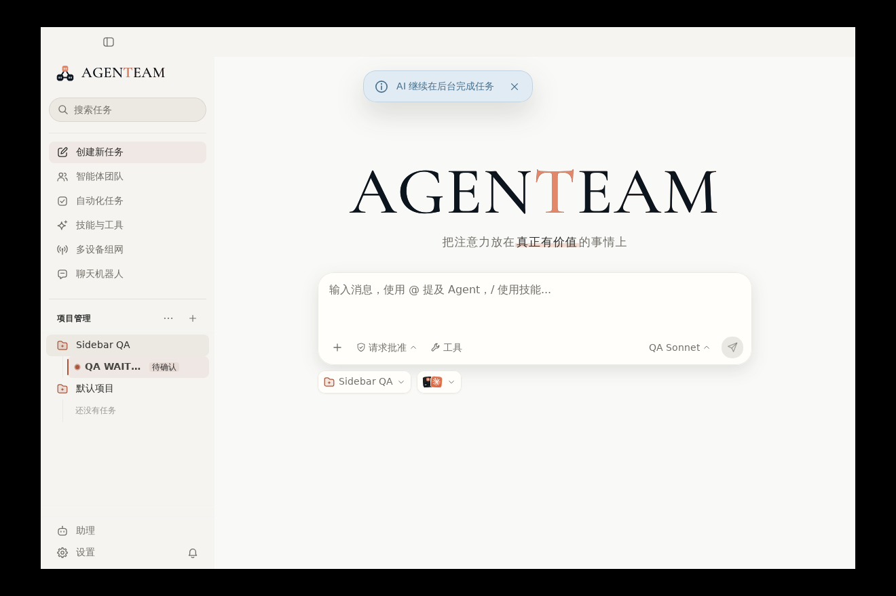
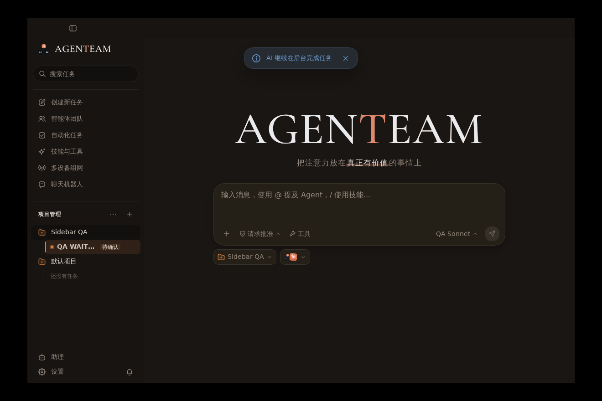

# 侧栏任务状态提示独立验收

验收提交为 `09e3294c1ad8351e69fa4068d2d0d248a152d4df`。功能分支的基线为 `a6c3410a`。Rust Clippy 基线 `d0daecbf` 与其代码一致，仅少一份后台验收文档。验收依据为 `origin/handoff/knowledge-base:specs/handoff/session_status/README.md` 和知识库门禁。方案 C 采用 README 的文字规则，方案图未能读取。后台 60 分钟预算修复的独立复验见 `fix/bg-completion-human-wait@860e531c` 的同名报告。功能树附有 [后台验收初稿](acceptance-bg-timeout.md)。

首轮提交 `f9b860d0` 的独立验收记录保存在本地 `codex/sidebar-qa-f9b860d0` 的 `cc267210`。该提交中，同一 Sidecar 进程换绑新会话时，旧会话的排队上报可以被归到新会话。此次重新核对相同边界。

## 验收结论

**有条件通过。** AC-S-1 至 AC-S-10 均有通过证据。Clippy 新增告警为 0。按整文件统计的改动模块零告警门禁仍相差 16 条基线告警。Windows 候选全量集成的 33 项失败都出现在全量基线中。Linux 候选全量集成的 5 项失败均由定向基线复验复现。

## 验收项

| 项目 | 结果与证据 |
|---|---|
| AC-S-1 | 通过。完整 Rust 库的 `projects_run_wait_resume_and_terminal_states`、`retirement_clears_live_state_without_clearing_error` 验证运行、待确认、恢复、完成、主动停止和错误保留。 |
| AC-S-2 | 通过。独立 Rust 探针在关闭旧派发门、停止、同端口新代次三个边界送入旧上报，新代次保留运行态。移除 Sidecar 后运行态清除。产品测试另覆盖同进程换绑拒绝旧逻辑凭据，以及同会话从 pending 槽升级真实 ID 保留活动。 |
| AC-S-3 | 通过。独立 Rust 探针启动真实回环 Management API。外部 Bearer 返回 401，有内部身份但缺少活动凭据也返回 401。带 `sessionId`、`sidecarId`、`generation` 或未知字段的 body 返回 422。 |
| AC-S-4 | 通过。Renderer 单测对监听先于快照、快照等待时收到的事件按顺序重放做了断言。 |
| AC-S-5 | 通过。DOM 用例覆盖五态优先级、选中态、折叠汇总、待确认说明和可访问名称。 |
| AC-S-6 | 通过。DOM 用例替换活动 Tab 后继续检查侧栏会话状态和折叠汇总。 |
| AC-S-7 | 审查通过。Rust 在 SidecarManager 锁内按活跃进程代次和逻辑会话凭据定位上报归属。新逻辑会话在生命周期入口取得新凭据，换绑拒绝时旧凭据仍有效。Node 排队时保存采样凭据，回归验证旧队列消息在换绑后仍携带旧凭据。运行时上报点位于内置与外置 adapter 公共路径。路由委托 SessionEngine，Renderer 只投影 Rust 快照与事件，错误确认经 Rust，完成未读复用现有通知计数。 |
| AC-S-8 | 真实 App 通过。内置 Claude Agent SDK 触发 AskUserQuestion，切换到「创建新任务」后原会话立即显示暖色整行与「待确认」。折叠项目显示暖色点和数量 1。重新打开原会话、选择「继续」并提交后，会话先显示运行点，完成后只显示时间。浅色与深色均复验。 |
| AC-S-9 | 真实 App 通过。合成服务收到请求后返回 HTTP 401，期间切到「创建新任务」。原会话行尾出现警告，打开会话后恢复为时间。 |
| AC-S-10 | 真实 App 通过。向隔离 TaskStore 预置一条一次性定时任务，Rust 调度器在 17:26:43 UTC 触发内置 Sidecar。打开「显示自动化历史」后，新会话行显示绿色运行点，折叠项目也显示绿色点。任务完成后两处运行点清除。任务记录为 `trigger=scheduled`、`success=true`、`status=done`、执行次数 1。 |

## D1 至 D9

| 门禁 | 结果与证据 |
|---|---|
| D1 | `npm run typecheck` 退出 0。 |
| D2 | `npm run lint` 退出 0。ESLint 0 警告，依赖检查 0 错误和 17 条基线孤立模块警告，文档检查 4 项通过。差异审查无新增 suppress、跳过测试标记或依赖规则豁免。 |
| D3 | 分类检查通过（375 个服务器测试，含 87 个集成文件和 6 个 credentialed 测试）。受影响单测 219/219，DOM 129/129。Windows 全量集成候选为 1,021 通过、33 失败、20 个既有条件跳过，基线为 1,020 通过、34 失败、20 个既有条件跳过。对照完整测试名，候选独有失败 0，双方全量仍有失败。Windows 基线独有一项 MCP OAuth 调度断言。Linux 候选完整集成为 1,049 通过、5 失败、20 个既有条件跳过。5 个同名失败均在隔离 Linux 基线的定向复验复现。Linux 完整基线仍在运行，补充证据见下文。 |
| D4 | Rust 1.92.0 锁定依赖的完整库测试中，`session_activity` 8/8、`sidecar::` 136/136、`session_goal::manager` 21/21、`memory_auto_update` 27/27。活动与 Sidecar 筛选有重叠。独立 Rust 探针仅在临时源码快照加入测试，`cargo test --manifest-path src-tauri/Cargo.toml --lib independent_activity_ -- --test-threads=1` 执行 2/2，通过且 0 忽略。Clippy 0.1.92 的两次 `--all-targets --message-format=json` 均成功，告警去重 213 → 213，新增 0。新 `session_activity.rs` 与改动行均为 0。文件级模块仍有 16 条既有告警，详见下文。 |
| D5 | Windows 复跑将候选和基线各自的子进程 USERPROFILE 及临时目录置于 D 盘，并在运行前验证 Node `os.homedir()`。Linux 使用断网容器和独立系统用户目录。真实索引保持最后修改时间 08:01:11、大小 43,368 字节，前一轮真实用户目录写入情况见下文。 |
| D6 | Rust、Node、Renderer 具有相应回归覆盖，执行结果见 AC-S-1 至 AC-S-6、D3 和 D4。 |
| D7 | [架构](../../ARCHITECTURE.md)、[会话架构](../../tech_docs/session_architecture.md) 和 [侧栏设计](../../design/app_shell.md) 已更新 Rust owner、代次与换绑、上报路径、错误生命周期、方案 C。 |
| D8 | 状态文案及可访问名称进入 zh-CN 和 en-US。主题色使用 token，状态动画遵从 Reduced Motion。 |
| D9 | `git diff --check a6c3410a 09e3294c` 通过。功能差异落在会话活动链路、侧栏和相应架构文档。 |

`management_api.rs` 3 条、`session_goal/manager.rs` 1 条、`sidecar/manager.rs` 5 条、`sidecar/session_lifecycle.rs` 7 条。四个文件的主跨度告警与基线一致，位置均在本次未改行。按整文件理解的「改动模块 0 告警」尚有这 16 条差距。

历史 Windows 集成运行只替换了 HOME。Node 在 Windows 从 USERPROFILE 读取 `os.homedir()`，使测试写入真实 `.agenteam` 会话目录。只读核对记录 41 条索引，至少 8 条可辨认的测试记录，影响窗口涉及 29 个 transcript 文件和 1 个 sessions-v2 文件。当时已向用户披露。真实数据保留原状，复跑使用隔离目录。

## Linux 集成补充证据

完整候选运行覆盖 87 个集成文件，85 个通过，1 个失败，1 个既有条件跳过。失败集中在 `external-session-mock.integration.test.ts`。对 `a6c3410a` 使用独立用户目录复跑同名断言，以下 5 项全部复现，另有同一参数组的 2 项通过。

| 断言 | Linux 候选完整运行 | Linux 基线定向复跑 |
|---|---|---|
| Codex Managed 入口在产品 IO 故障时接纳 IM 建立及 Inbox/Task/Goal/Heartbeat | 失败 | 同名失败 |
| 使用当前 Host dispatcher 恢复健康的 0.146 产品会话 | 失败 | 同名失败 |
| 缺少必须的系统 Skill 时只拒绝依赖它的 Managed turn | 失败 | 同名失败 |
| 被拒绝的 guarded Codex send 向未预热进程传递 failure 清理意图 | 失败 | 同名失败 |
| 被拒绝的 guarded Codex send 向预热进程传递 failure 清理意图 | 失败 | 同名失败 |

两个完整 Windows 运行已按完整测试名比较。Linux 的成对结论限于上表五项。

## 真实应用证据

从 `09e3294c` 归档构建原生 Linux Tauri 应用和同版本的 Renderer、Sidecar 产物。验证运行于断网容器，两个系统用户分别使用独立浅色和深色配置。内置运行时为 Node 24.20.0 与 Claude Agent SDK 0.3.330。模型响应由仅监听回环地址的合成服务提供。Linux 调试构建沿用正式包的资源相对布局。应用二进制 SHA-256 为 `dd3ad6ad8fdd63d3833e02102e4ed77861d49b933b207b8d3311b61f14c6719e`，Sidecar 脚本为 `d8aa8701c048e322405e38eb596233357035e8494624eeb4ebfc89113cfeca3e`。

**浅色主题**。切到「创建新任务」后，原会话仍显示「待确认」。

[折叠计数](evidence/acceptance-light-collapsed.png) · [提交批准后运行](evidence/acceptance-light-running.png) · [完成后回到空闲](evidence/acceptance-light-complete.png)

**深色主题**。切到「创建新任务」后，原会话仍显示「待确认」。

[折叠计数](evidence/acceptance-dark-collapsed.png) · [提交批准后运行](evidence/acceptance-dark-running.png) · [完成后回到空闲](evidence/acceptance-dark-complete.png)

**后台失败**。警告图标随打开会话清除。[切出后失败](evidence/acceptance-error-background.png) · [打开后清除](evidence/acceptance-error-opened.png)

**自动化会话**。定时执行期间，运行点跟随会话和折叠项目。[会话运行](evidence/acceptance-scheduled-running.png) · [项目折叠](evidence/acceptance-scheduled-collapsed.png) · [定时任务结束](evidence/acceptance-scheduled-finished.png)
